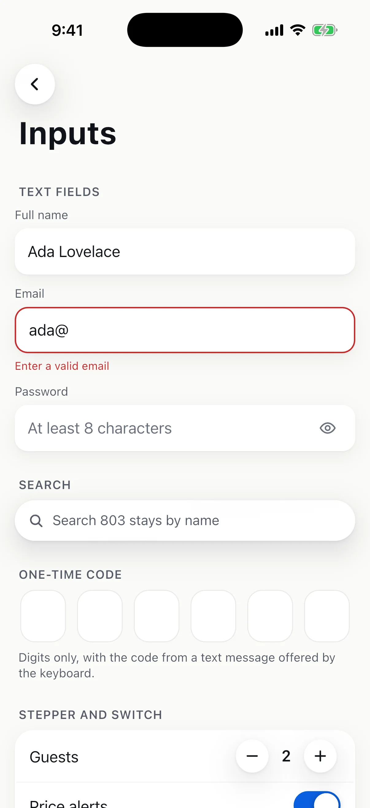

# Inputs

`SheenTextField`, `SheenPasswordField`, `SheenSearchField` and `SheenCodeField` (one-time codes), plus
`SheenSwitch`, `SheenCheck` (a check box with its label, for an agreement or an opt-in), `SheenSlider` and
`SheenStepper`. The fields use Flutter's `TextField` and work under any app.

